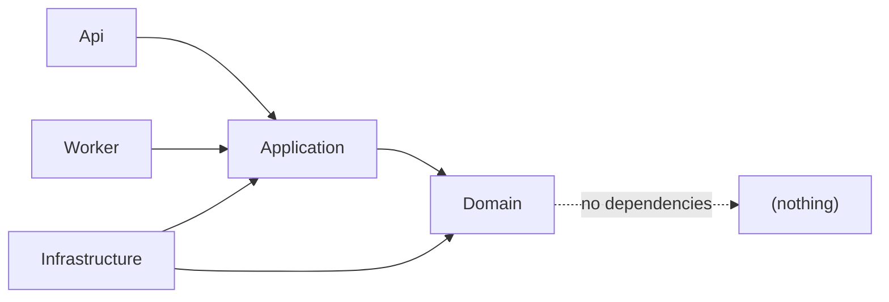

# TallyBalance AI — Dependency Rules

**Phase:** 0
**Status:** Draft for developer review

These rules are **enforced by automated architecture tests** in
`tests/TallyBalance.ArchitectureTests`, not by convention. A violation fails CI.

---

## 1. Layer dependency direction



| Project | May reference | Must NOT reference |
|---|---|---|
| `Domain` | BCL only | Everything else, incl. EF Core, ASP.NET |
| `Application` | `Domain`, `Shared` | `Api`, `Infrastructure`, `Worker`, EF Core, ASP.NET, RabbitMQ, Redis, Qdrant, any SDK |
| `Infrastructure` | `Application`, `Domain`, `Shared`, external SDKs | `Api`, `Worker` |
| `Api` | `Application`, `Domain` (DTO mapping only), `Shared` | `Infrastructure` **except in the composition root** |
| `Worker` | `Application`, `Domain`, `Shared` | `Api` |

### The composition-root exception
`Program.cs` (and `DependencyInjection.cs` extension methods) is the **only** place where
`Api`/`Worker` may reference `Infrastructure` — to bind ports to adapters. This is deliberate:
composition roots are allowed to know about concrete types; business code is not.

Architecture tests must whitelist composition-root files for this rule and forbid it everywhere else.

---

## 2. Dependency Inversion at the module boundary

`Application` defines **ports** (interfaces). `Infrastructure` implements **adapters**.

```
Application                          Infrastructure
────────────                         ──────────────
IFileStorageService          ←──────  LocalFileStorageService
ILLMProvider                 ←──────  OpenAiCompatibleLlmProvider
IEmbeddingProvider           ←──────  OpenAiCompatibleEmbeddingProvider
IDocumentTextExtractor       ←──────  PdfTextExtractor
IInvoiceExtractionService    ←──────  LlmInvoiceExtractionService
IRetrievalService            ←──────  QdrantRetrievalService
IAIAnalysisService           ←──────  LlmAnalysisService
ICurrentUser                 ←──────  HttpCurrentUser
ITenantContext               ←──────  HttpTenantContext
IClock                       ←──────  SystemClock
```

**Why inverted:** business logic must not depend on delivery mechanisms. The extraction use case
should be testable with a fake `ILLMProvider` in milliseconds, with no network and no API key.

---

## 3. Abstraction discipline (anti-over-engineering)

The spec is explicit: **do not create interfaces for every class.**

Create an interface only when at least one is true:

1. The dependency is **external** (network, filesystem, clock, randomness) — needed for testability.
2. There is a **realistic second implementation** (e.g. Local disk → MinIO → Azure Blob).
3. It is a **cross-module contract** (Rule M2 in module-boundaries).
4. It breaks a **cycle** or inverts a dependency direction.

Do **not** create an interface when:
- there will only ever be one implementation and no test need (e.g. a simple internal mapper);
- it exists purely to *look* enterprise-grade;
- it adds a layer that only forwards calls unchanged.

Concrete internal services, repositories used only through EF Core `DbContext`, and pure domain
helpers stay as concrete classes.

**Repositories:** use repository abstractions **only where they add value** — typically where a
module needs a collection-like abstraction over an aggregate for testability. Otherwise use the
`DbContext` directly inside `Infrastructure` with well-scoped query methods. A repository that is
a one-line passthrough to `DbSet` is ceremony, not architecture.

---

## 4. Module dependency rules

Restated from `module-boundaries.md` as enforceable assertions:

- **D1** — No cycles between modules.
- **D2** — Module A must not reference Module B's domain entities.
- **D3** — Module A must not reference Module B's `DbSet`/`DbSet`-returning members.
- **D4** — Cross-module calls target an application-layer contract interface only.
- **D5** — Modules must not reference `TallyBalance.Api` types (controllers, filters, middleware).
- **D6** — `Shared` must contain no business logic and no dependencies on modules.
- **D7** — Domain events must be immutable records (`record` with `init`/positional params).

---

## 5. Namespace conventions

```
TallyBalance.Modules.<Module>.Domain
TallyBalance.Modules.<Module>.Domain.Events
TallyBalance.Modules.<Module>.Application.Commands
TallyBalance.Modules.<Module>.Application.Queries
TallyBalance.Modules.<Module>.Application.Contracts      # ports other modules implement/consume
TallyBalance.Modules.<Module>.Application.Dtos
TallyBalance.Modules.<Module>.Api
TallyBalance.Infrastructure.<Module>                     # adapters, EF configuration
TallyBalance.Shared
```

Namespaces are load-bearing: architecture tests assert on them. A misplaced file is a build failure,
not a code-review nitpick.

---

## 6. Forbidden patterns

| Pattern | Why forbidden |
|---|---|
| EF Core entities returned from API endpoints | Leaks schema, creates serialization cycles, couples clients to persistence |
| `decimal` → `double`/`float` for money | Binary floating point cannot represent currency exactly |
| `DateTime.Now` in business code | Local-timezone ambiguity; use `IClock` + UTC `DateTimeOffset` |
| `async void` (except event handlers) | Unobserved exceptions, no awaitability |
| `.Result` / `.Wait()` on tasks | Thread-pool deadlock risk |
| Missing `CancellationToken` on I/O paths | Requests cannot be cancelled; threads leak |
| `catch { }` / catching generic `Exception` to swallow | Hides real failures |
| Trusting client-supplied `OrganizationId` | Cross-tenant data access |
| Trusting client-computed totals | Financial integrity |
| `SaveChanges()` inside a loop without a deliberate transaction boundary | Partial writes, N round-trips |
| Generic `PUT /invoices/{id}` that can set `Status` | Bypasses the state machine |
| Retry of a financial write whose outcome is unknown | Duplicate financial effect |
| Storing secrets in source or `appsettings.json` | Credential leakage |
| Disabling certificate validation or security middleware for convenience | Insecure-by-design |
| AI executing a financial/approval action without human confirmation | Violates the core AI safety rule |

---

## 7. Transaction and concurrency rules

- **T1** — Every multi-entity write is inside an explicit transaction boundary.
- **T2** — The financial adjustment path writes invoice state, adjustment record, history record,
  and outbox event in **one** transaction.
- **T3** — Entities subject to concurrent mutation carry `RowVersion` (`rowversion` column) and
  the API surfaces it as an ETag / concurrency token.
- **T4** — Concurrency conflicts produce **409 Problem Details** with current state. Never a
  silent overwrite, never a blind retry.
- **T5** — Every financial mutation accepts an `IdempotencyKey`; duplicates return the original
  result rather than re-applying.
- **T6** — Publishing to RabbitMQ never happens inside a database transaction. Events go to the
  **outbox table** in the transaction; a separate publisher sends them after commit.

---

## 8. Async and cancellation rules

- **A1** — All I/O methods are `async` and accept `CancellationToken`, propagated end to end.
- **A2** — Background consumers honour cancellation on shutdown and requeue rather than lose work.
- **A3** — No blocking waits on async code.
- **A4** — AI provider calls always have a configured timeout and cancellation path; a slow model
  must never hang a request thread.

---

## 9. Validation rules

- **V1** — DTO-level structural validation via FluentValidation at the API edge.
- **V2** — Business-rule validation in the domain/application layer. **Both** layers validate;
  the edge validates shape, the domain validates truth.
- **V3** — Financial reconciliation (line totals vs invoice totals) is validated server-side on
  every mutation, not only on submit.
- **V4** — Frontend Zod validation is a UX convenience and is never a security or integrity control.

---

## 10. Enforcement

`tests/TallyBalance.ArchitectureTests` contains assertions equivalent to:

```csharp
// Illustrative — actual implementation in Phase 1
Types.In(assemblyOf<Domain>())
     .That().AreClasses()
     .Should().NotDependOnAny(assemblyOf<Infrastructure>());

Types.In(module: "Adjustments")
     .That().HaveNamespaceStartingWith("...Adjustments.Domain")
     .Should().NotDependOnAny(assemblyOf<Api>());

// No controller may return a type from a Domain namespace
// No type outside Infrastructure may reference RabbitMQ.Client, StackExchange.Redis, Qdrant.Client
```

These tests run on every CI build. **A dependency violation is a build failure**, which is the only
reliable way to keep a modular monolith modular as it grows.
