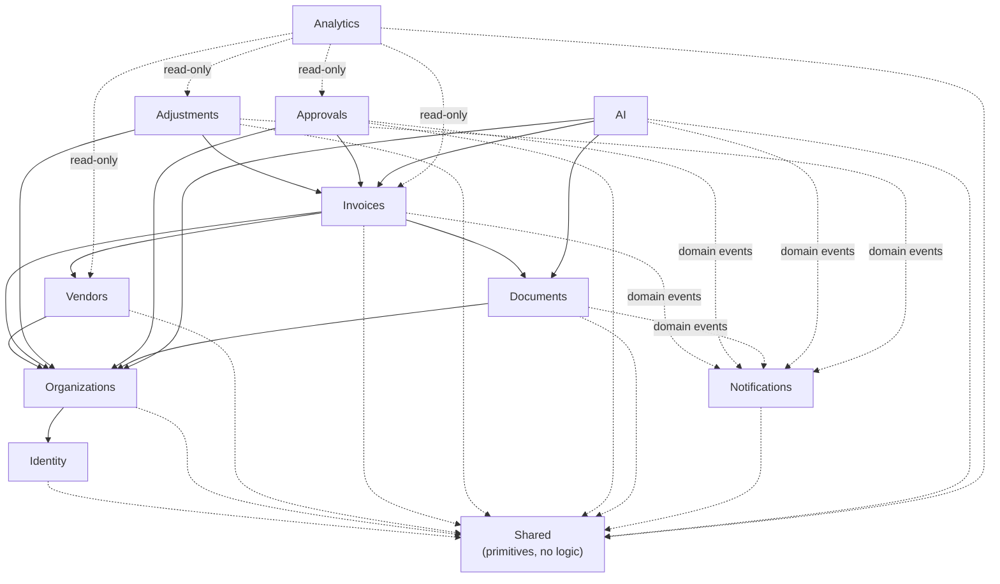

# TallyBalance AI — Module Boundaries

**Phase:** 0
**Status:** Draft for developer review

---

## 1. What a "module" means here

A module is a **vertically sliced, self-contained business capability** inside a single deployable
process. It is *not* a microservice.

Each module owns:

- its **domain entities** and invariants;
- its **application use cases** (commands/queries);
- its **API endpoints**;
- its **database tables** (no other module writes them directly);
- its **domain events** published to other modules.

Each module does **not** own: HTTP plumbing, DI registration boilerplate, logging configuration,
or database connection management. Those are host concerns.

**Vertical slice vs layer:** Clean Architecture layers (`Api`, `Application`, `Domain`,
`Infrastructure`) are the *horizontal* axis. Modules are the *vertical* axis cutting through them.
A file's layer tells you *what kind of code* it is; its module tells you *what business capability*
it serves.

---

## 2. Module inventory

### Identity
| | |
|---|---|
| **Owns** | User, Role, Permission, UserRole, RolePermission, RefreshToken, UserSession, PasswordResetToken |
| **Provides** | Authentication, token issuance/rotation/revocation, authorization policy definitions, current-user context |
| **Consumes from others** | Nothing (foundational) |
| **Notes** | Must remain organization-agnostic. Identity knows *who* you are; Organization knows *which tenant* you belong to. |

### Organizations
| | |
|---|---|
| **Owns** | Organization, OrganizationMember, OrganizationSettings, OrganizationInvitation |
| **Provides** | Tenant resolution, membership checks, tenant context, org settings, currency preference |
| **Consumes from others** | Identity (to create invited users, resolve permissions) |
| **Notes** | The **tenant authority**. Every other tenant-owned module depends on its membership check. Never trust a client-supplied `OrganizationId`. |

### Vendors
| | |
|---|---|
| **Owns** | Vendor, VendorContact, VendorAddress |
| **Provides** | Vendor CRUD, search, vendor spending summary, vendor status |
| **Consumes from others** | Organizations (tenant), Invoices (read-only history via published query) |
| **Notes** | Uniqueness rules are **organization-scoped**, not global. Never expose full payment identifiers. |

### Invoices
| | |
|---|---|
| **Owns** | Invoice, InvoiceLineItem, InvoiceStatusHistory, Payment, TdsDeduction, InvoiceDocument join |
| **Provides** | Invoice lifecycle via the **state machine**, line item management, totals reconciliation, payment recording and derived balances, TDS computation and derived net payable, search/filter/export |
| **Consumes from others** | Organizations (tenant + financial settings), Vendors, Documents (attachment refs), Adjustments (derived totals) |
| **Notes** | The core module. Status changes happen **only** through explicit transition commands, never a generic update. Line-item totals must reconcile with invoice totals. |

**Financial configuration is owned by Organizations, not Invoices.** `TaxMode`, `DiscountMode`, and
the rounding policies live in `OrganizationSettings`. Invoices reads them through an
`IFinancialSettingsQuery` contract and **snapshots the effective mode onto the invoice**
(`EffectiveTaxMode` / `EffectiveDiscountMode`) at creation. Without the snapshot, an administrator
changing a setting would instantly make previously-valid invoices fail their own reconciliation check
— the same hazard that approval workflow versioning already solves.

**Payments are in scope.** `PaidAmount` and `OutstandingAmount` are derived from `Cleared` payments,
recomputed inside the payment write transaction, and stored only for read performance. Reversals are
append-only. Payment recording requires an idempotency key, exactly like adjustments.

**TDS is in scope and GST rates are reference-validated.** The Invoices module owns the
`TDS_DEDUCTIONS` append-only ledger. `TDS_SECTIONS`, `TDS_RATE_RULES` and `GST_RATES` are reference
data read through query contracts, never mutated by invoice code paths.

Two rules matter here:

- **No rate literals in application code.** The TDS rate is resolved from
  `(SectionCode, VendorType, PanQuoted)` against reference data, and the GST rate from `HsnSacCode`
  plus the invoice date. Hardcoding a rate would make every budget change a code deploy and would
  silently break reproducibility of historical invoices.
- **Rates are snapshotted onto the record.** Each line item stores `GstRateId` and
  `GstRateEffectiveFrom`; each TDS deduction stores `RatePercent` and `SectionCode`. Regulation
  changes; historical documents must not change with it.

`TdsAmount` and `NetPayableAmount` follow the same derived-but-stored discipline as `PaidAmount`:
recomputed in the deduction transaction, rebuildable from the ledger, derived wins on disagreement.

**Ownership of reference tables (Rule M6).** `GST_RATES`, `TDS_SECTIONS` and `TDS_RATE_RULES` are
**platform-level, not tenant-scoped** — they carry no `OrganizationId`. They are owned by the
Invoices module's reference-data sub-area, populated through migrations and a super-administrator
seeding path only. No tenant-facing endpoint may write them, which is why they are absent from the
tenant-owned entity list in the ER diagram.

### Adjustments
| | |
|---|---|
| **Owns** | Adjustment, AdjustmentHistory, AdjustmentOperationHistory, IdempotencyRecord |
| **Provides** | Apply/undo/redo adjustments, adjustment timeline, active-state projection |
| **Consumes from others** | Invoices (line items), Organizations, Identity (actor) |
| **Notes** | **Append-only ledger.** Undo does not delete; it writes a compensating event and flips active state. Every undo/redo is itself auditable. Requires `RowVersion` + explicit transaction + idempotency key. Highest test rigor in the codebase. |

### Approvals
| | |
|---|---|
| **Owns** | ApprovalWorkflow, ApprovalWorkflowVersion, ApprovalStage, ApprovalRequest, ApprovalAssignment, ApprovalAction, ApprovalComment |
| **Provides** | Workflow definition/versioning, stage evaluation, assignment, approve/reject/request-changes, pending tasks |
| **Consumes from others** | Invoices (amount, status), Organizations (roles/thresholds), Identity (approver identity) |
| **Notes** | Definitions are **versioned**; in-flight requests pin the version they started with, so editing a workflow never mutates live approvals. Transitions are transactional. Only the assigned approver may decide their own task. |

### Documents
| | |
|---|---|
| **Owns** | Document, DocumentVersion, DocumentProcessingJob, DocumentExtractionResult |
| **Provides** | Secure upload, content validation, hashing, storage, download/preview authorization, processing lifecycle |
| **Consumes from others** | Organizations (tenant), Invoices (association) |
| **Notes** | Treats all uploaded bytes as hostile. No trust in extension or client content-type. Server-generated storage names. No binaries in SQL Server. Lifecycle: Uploaded → PendingProcessing → Processing → Extracted → AwaitingReview → Completed (+ Failed / Rejected / Quarantined). |

### Notifications
| | |
|---|---|
| **Owns** | Notification, NotificationPreference, NotificationDeliveryAttempt |
| **Provides** | In-app notification creation, delivery attempts, retry/DLQ handling, preferences |
| **Consumes from others** | Domain events from Invoices, Approvals, Documents, AI |
| **Notes** | Purely **event-driven** — other modules never call it directly. Must deduplicate. Email behind a provider abstraction (mock/SMTP initially). |

### AI
| | |
|---|---|
| **Owns** | AIAnalysis, AIConversation, AIConversationMessage, AIEmbeddingReference, AIRecommendation, AIActionRequest, AIEvaluationResult |
| **Provides** | Extraction, summarisation, RAG Q&A, duplicate/anomaly assistance, suggested actions |
| **Consumes from others** | Documents (text), Invoices (structured data), Organizations (tenant filter) |
| **Notes** | **Advisory only.** Never mutates financial state. Suggested actions land in `AIActionRequest` awaiting explicit human confirmation. Retrieval is tenant- and authorization-filtered *before* context construction. |

### Analytics
| | |
|---|---|
| **Owns** | Read models / materialized aggregates (own tables only) |
| **Provides** | Dashboard metrics, reports, CSV export |
| **Consumes from others** | Read-only queries across modules, or event-maintained projections |
| **Notes** | Aggregation happens in the **backend**. Never ship all rows to the browser to compute metrics. Document which numbers are live vs cached. |

### Shared (not a module)
Cross-module primitives with **no business logic**: `Result<T>`, domain event contracts,
`IOrganizationOwned`, `ICurrentUser`, `ITenantContext`, correlation-ID helpers, clock abstraction.

---

## 3. Module dependency map



**Solid arrows** = direct dependency (may call the other module's application contracts).
**Dotted arrows** = asynchronous, via domain events / outbox only.

---

## 4. Interaction rules

### Rule M1 — No cross-module entity access
Module A must never reference Module B's entity types or `DbSet`s. Only the owning module touches
its own tables.

### Rule M2 — Cross-module reads go through explicit contracts
If Invoices needs vendor data, Vendors exposes a query contract (e.g. `IVendorQueryService`) in
its application layer. Invoices depends on the **contract**, never the implementation or entity.

### Rule M3 — Cross-module writes go through events
Notifications, Analytics, and AI react to domain events. No module reaches into another module to
create records. This is what keeps the eventual service-extraction path realistic.

### Rule M4 — Cycles are forbidden
The dependency graph must be a DAG. Architecture tests enforce this. If a cycle appears, the fix
is to invert the dependency with an event or extract the shared concept into `Shared`.

### Rule M5 — Events are declared in the publishing module, consumed anywhere
Event contracts are records in the publisher's `Events` namespace, registered in the outbox in the
same transaction as the state change.

### Rule M6 — One module owns each table
Foreign keys across modules are allowed (Invoices → Vendors), but only the owning module writes.
`ON DELETE` behaviour for financial records is **never** cascade-delete; it is `NO ACTION` with an
application-level guard, so a vendor with invoices cannot be silently destroyed.

---

## 5. Project layout mapping

```
src/
  TallyBalance.Api/            # host: controllers/endpoints, middleware, DI wiring
  TallyBalance.Application/    # use cases, ports, shared contracts
  TallyBalance.Domain/         # entities, invariants, state machines, domain events
  TallyBalance.Infrastructure/ # EF Core, adapters, external SDKs
  TallyBalance.Worker/         # BackgroundService consumers

  Modules/
    Identity/        → Identity.Api / Identity.Application / Identity.Domain
    Organizations/   → ...
    Vendors/
    Invoices/
    Adjustments/
    Approvals/
    Documents/
    Notifications/
    AI/
    Analytics/

  Shared/
```

**Pragmatic note:** for the first phases, modules are **folders and namespaces inside the four
core projects**, not separate assemblies. Physical assembly separation is introduced when a module
is genuinely stable, because premature assembly splitting multiplies build time and ceremony
without adding safety that architecture tests don't already give us. The dependency rules below are
enforced by **NetArchTest/ArchUnit-style architecture tests** regardless of assembly layout —
which is the point.

---

## 6. Extraction path (if a module ever becomes a service)

Because modules already (a) own their tables, (b) never read another module's entities, and
(c) communicate outward via events, extraction is mostly:

1. Move the module's projects into a new solution.
2. Replace in-process event dispatch with RabbitMQ.
3. Give it its own database.
4. Keep the shared event contracts in a versioned package.

This is a documented option, **not a plan**. Premature microservices would add distributed-
transaction complexity to the adjustment engine, which is exactly the wrong trade-off.
