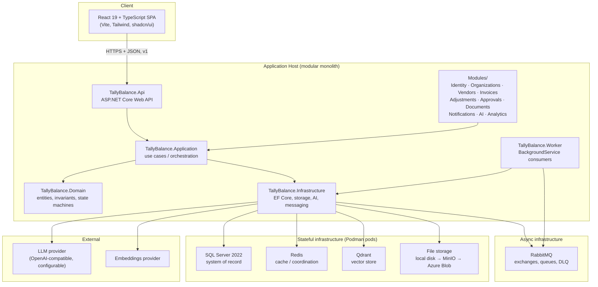
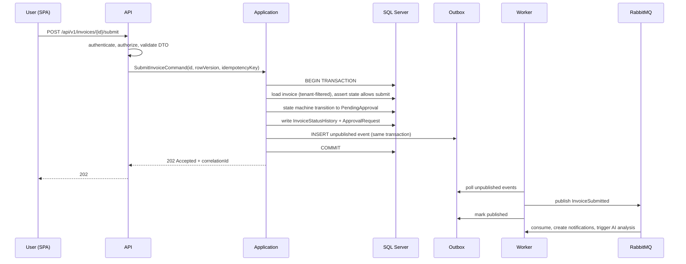

# TallyBalance AI — System Overview

**Phase:** 0 — Project Discovery and Architecture
**Status:** Draft for developer review
**Last updated:** 2026-11-10

---

## 1. Purpose

TallyBalance AI is an AI-powered financial operations (accounts payable / invoice lifecycle)
SaaS platform. This document describes the **system-level architecture** before any code is written.

It answers: *what components exist, how do they communicate, and where does each responsibility live?*

---

## 2. Environment (verified, not assumed)

All tooling below was verified on the development machine on 2026-11-10.

| Component | Version | Install scope | Notes |
|---|---|---|---|
| .NET SDK | **10.0.403** | User-level (`%LOCALAPPDATA%\Microsoft\dotnet`) | Installed via `dotnet-install.ps1`. No admin used. |
| Node.js | 24.20.0 | Pre-installed | Current LTS line |
| npm | 11.19.0 | Pre-installed | |
| Git | 2.55.0 | Pre-installed | Repo initialised, branch `main` |
| Podman | 6.0.2 | Pre-installed | WSL-based machine `podman-machine-default` |
| docker-compose | 2.39.4 | User-level (`%LOCALAPPDATA%\Microsoft\dotnet-tools`) | Drives the **Podman** engine |
| winget | 1.29.380 | Pre-installed | Available but **not used** for machine-wide installs |

### Hard environment constraints

These are not preferences — they are verified limitations that shape every later phase.

1. **No administrator privileges are available.** Nothing in this project may require elevation.
   All tooling is installed at user scope. Any approach that triggers a UAC prompt is rejected
   outright, not retried with variations.
2. **`podman machine set --memory/--cpus` is unsupported for WSL machines.** Resource sizing is
   controlled by `%USERPROFILE%\.wslconfig` instead. This file has been created with
   `memory=8GB, processors=4, swap=4GB`, and the VM now reports **7.8 GiB** total.
   (It started at 2 GiB, which is insufficient for SQL Server alone.)
3. **No local SQL Server instance and no LocalDB.** SQL Server runs only as a container.
4. **PowerShell execution policy is `RemoteSigned` (CurrentUser).** Downloaded scripts must be
   `Unblock-File`-d before execution.

### Container runtime decision

Per the project rule, **Podman is the container engine — Docker is not installed and the Docker
daemon is not used.**

Compose files are written in standard Compose format and executed with the **`docker-compose`
binary against Podman's Docker-compatible API socket** (`npipe:////./pipe/docker_engine`), which
Podman exposes natively. This was chosen over `podman-compose` because:

- the Compose-spec implementation in docker-compose is more complete and better documented;
- it keeps compose files portable and conventional;
- it was **smoke-tested successfully** against Podman before being adopted.

The engine underneath is still Podman. No Docker daemon, no Docker Desktop, no Docker dependency.
If this combination ever fails, fall back to `podman-compose` and record the change in an ADR.

See `docs/adr/ADR-008-container-runtime-podman.md`.

---

## 3. High-level architecture

Modular monolith. One deployable API process, one background worker process, internally divided
into modules with enforced dependency rules.

### Why this shape

- **One API process** keeps transactions simple where transactions matter most — the financial
  adjustment engine, which needs a real database transaction spanning invoice + adjustment +
  history + outbox writes. Splitting that across services would force distributed transactions
  or saga complexity for no benefit at this scale.
- **A separate worker process** is still worth it, because document extraction and AI calls are
  slow, and running them inside the API process would tie up request threads and make API latency
  depend on model-provider latency.
- **Modules are namespaces and project boundaries, not services.** They give us enforceable
  architecture rules now, and a documented extraction path later if a module ever genuinely needs
  to be split out.

---

## 4. Component responsibilities

### TallyBalance.Api
- HTTP endpoints, versioned under `/api/v1`.
- Model binding, DTO validation (FluentValidation), authentication/authorization enforcement.
- Problem Details error responses, correlation ID assignment, rate limiting.
- **Never** contains business rules. **Never** exposes EF Core entities as contracts.

### TallyBalance.Application
- Use cases / command and query handlers.
- Transaction boundaries, orchestration, outbox writes.
- Defines the **ports** (interfaces) it needs: `IFileStorageService`, `ILLMProvider`,
  `IEmbeddingProvider`, `IDocumentTextExtractor`, `IInvoiceExtractionService`,
  `IRetrievalService`, `IAIAnalysisService`, `ICurrentUser`, `ITenantContext`.
- Depends on Domain only. Knows nothing about EF Core, HTTP, or RabbitMQ.

### TallyBalance.Domain
- Entities, value objects, domain events, invariants.
- The **invoice state machine** and **adjustment ledger semantics** live here as pure C#,
  independently unit-testable without a database.
- Zero external dependencies. No EF Core attributes, no ASP.NET types.

### TallyBalance.Infrastructure
- EF Core `DbContext`, migrations, tenant query filters, concurrency configuration.
- Adapters implementing the Application ports: SQL Server, Redis, RabbitMQ, Qdrant, file storage,
  LLM providers, PDF extraction.
- This is the only project allowed to reference external SDKs.

### TallyBalance.Worker
- `BackgroundService` consumers: outbox publisher, document processing, extraction, embeddings,
  summarisation, reminders, notification delivery, analytics aggregation.
- Must reconstruct and preserve **tenant context** for every message it processes.

### Frontend (`frontend/TallyBalance-web`)
- React 19 + TypeScript strict, Vite, Tailwind, shadcn/ui, React Router, TanStack Query,
  React Hook Form + Zod, Recharts, Lucide.
- Feature-based folders. Centralised typed API client. No financial calculation as source of truth.

---

## 5. Cross-cutting strategies

### 5.1 Authentication strategy
- ASP.NET Core Identity for credential storage and password hashing.
- **Short-lived JWT access token** (10–15 min) + **opaque rotating refresh token**.
- Refresh token stored in an **HttpOnly, Secure, SameSite=Strict cookie**; access token kept in
  memory only in the SPA — never `localStorage`.
- Refresh token rotation with **reuse detection**: presenting a rotated token revokes the whole
  family and records a security event.
- Policy-based authorization layered on roles **and** granular permissions. Frontend hiding is
  presentation only; every protected operation is enforced server-side.
- Login throttling and rate limiting on all auth endpoints.

### 5.2 Tenant isolation strategy
Isolation is a **security boundary**, enforced in depth:

1. Tenant is resolved **from authenticated membership**, never from a request body `OrganizationId`.
2. `ITenantContext` is populated per request and flows into every query path.
3. EF Core global query filters on all `IOrganizationOwned` entities — as a **defence-in-depth
   convenience, explicitly not the security boundary**.
4. Repository/query boundaries assert tenant on every read and write.
5. Authorization handlers verify membership for the specific entity being touched.
6. Background jobs carry `OrganizationId` in the message envelope and re-establish context.
7. Cache keys and Qdrant filters are tenant-scoped.
8. Cross-tenant access is a **mandatory automated test category**, run in CI.

### 5.3 Error-handling strategy
- Single centralised exception-handling middleware.
- RFC 9457 **Problem Details** responses with a stable machine-readable `code`, a human message,
  and the correlation ID.
- Distinct exception types per concern: `ValidationException`, `NotFoundException`,
  `ForbiddenException`, `ConflictException` (concurrency), `BusinessRuleException`,
  `TransientFailureException`.
- Concurrency conflicts return **409 with the current state**, never a silent retry.
- Unknown-outcome financial operations are **never** blindly retried.
- No stack traces or internal storage paths in responses. No secrets in logs.

### 5.4 Logging and observability strategy
- Serilog structured logging; correlation ID on every log entry, propagated into messages.
- OpenTelemetry traces across HTTP → database → RabbitMQ → AI provider calls.
- Metrics: request count/duration/error rate, job success/failure, message processing duration,
  AI request duration and token usage.
- Health checks for API, SQL Server, Redis, RabbitMQ, Qdrant, file storage — **details redacted**
  on the public endpoint.

### 5.5 Financial correctness strategy

**Approved baseline (2026-11-10):** base currency **INR**, timezone **Asia/Kolkata**, and **payment
handling is in scope**.

- `decimal(19,4)` everywhere for money. **Never** `float`/`double`.
- Currency precision and rounding policy defined explicitly per currency. INR keeps paise (2 dp) for
  amounts, while **tax rounding is a separate configurable policy** — Indian GST practice commonly
  rounds tax to the nearest rupee while line amounts keep paise, so the two must not share one setting.
- **Tax and discount are configurable at both levels** (`PerLine` / `InvoiceLevel` / `Both`) via
  `OrganizationSettings.TaxMode` and `.DiscountMode`, editable on the **Settings → Financial
  Configuration** page, with optional per-invoice override. The effective mode is **snapshotted onto
  each invoice** at creation so a later settings change cannot retroactively invalidate stored totals
  — the same versioning principle used for approval workflow versions.
- Totals computed and validated **server-side only**. `TaxAmount`, `DiscountAmount`, `TotalAmount`,
  `PaidAmount` and `OutstandingAmount` are all derived; the API rejects any attempt to set them.
- **Payments** are first-class: a `PAYMENTS` table with `Cleared`/`Pending`/`Reversed`/`Voided`
  status, `PaidAmount` derived from cleared payments, a `PartiallyPaid` invoice state, and
  append-only reversals (never deleted).
- **GST rates are reference-validated, not free-entry.** Every line item carries a required
  `HsnSacCode` resolved against `GST_RATES` for the invoice date. Unknown codes are rejected rather
  than silently taxed at 0%. The resolved rate is snapshotted onto the line item so later rate
  revisions cannot alter historical invoices.
- **TDS is in scope.** `TDS_SECTIONS` / `TDS_RATE_RULES` reference data drive an append-only
  `TDS_DEDUCTIONS` ledger. Rate is resolved from `(SectionCode, VendorType, PanQuoted)` with **no rate
  literals in code**; a missing PAN falls through to the higher 206AA rate as a data rule. `TdsAmount`
  and `NetPayableAmount` are derived. Return filing, Form 16A and CHALLAN 280 are explicitly out of
  scope and documented as such.
- Adjustments are **append-only events** with active/inactive state; undo/redo are themselves
  auditable operations, never deletions.
- `RowVersion` optimistic concurrency on invoices, line items, adjustments, payments, and TDS
  deductions.
- Idempotency keys on every financial mutation — adjustments, payment recording, and TDS computation.

### 5.6 AI safety strategy
- Provider-independent ports; model names and endpoints in configuration only.
- Uploaded document text is **untrusted data**, never instructions. Prompt injection cannot
  override system policy.
- Structured output is parsed into a typed schema and **validated**; malformed output is rejected.
- Model-reported confidence is displayed but never treated as a calibrated probability.
- **AI never autonomously** adjusts amounts, approves invoices, changes payment details, or
  initiates payments. Every permitted business action requires explicit human confirmation.
- Retrieval is tenant- and authorization-filtered before context is built.

---

## 6. Data stores and their roles

| Store | Role | Why it exists |
|---|---|---|
| SQL Server | System of record. All financial truth, identity, audit, outbox. | ACID transactions, constraints, concurrency control. |
| Redis | Reference-data cache, dashboard cache, distributed rate limiting. | Reduce repeated reads; must be tenant-aware in keys. |
| RabbitMQ | Async work distribution, DLQ, retries. | Decouple slow processing from request latency. |
| Qdrant | Embeddings for RAG and semantic duplicate detection. | Similarity search that SQL cannot express. |
| File storage | PDF/image bytes. Local disk → MinIO → Azure Blob. | Never store large binaries in SQL Server. |

---

## 7. Request lifecycle example — "submit invoice for approval"

The critical property: the status change and the outbox event commit **atomically**. If the
process crashes after commit but before publishing, the event is still there and will be
delivered. This is how we get reliable publishing without distributed transactions.

---

## 8. Deployment topology

**Local development:** Podman pods for SQL Server, Redis, RabbitMQ, Qdrant (+ optional MinIO).
API and Worker run on the host via `dotnet run`; frontend via Vite dev server.

**Portfolio demonstration:** Azure App Service (or container hosting) for API and Worker,
Azure SQL Database, Azure Blob Storage, managed or containerised RabbitMQ/Redis.

Deployment is a **portfolio demonstration, not a production certification**, and documentation
states this honestly.

---

## 9. Decisions resolved by the developer (2026-11-10)

| # | Decision | Outcome |
|---|---|---|
| 1 | **Base currency** | **INR**, timezone `Asia/Kolkata`. Separate tax-rounding policy from amount-rounding policy (GST rounds tax to the nearest rupee; line amounts keep paise). Per-invoice currency still allowed for foreign vendor invoices. |
| 2 | **Tax / discount level** | **Configurable at both levels** — `PerLine`, `InvoiceLevel`, or `Both` — via organization settings, editable on the **Settings → Financial Configuration** page, with optional per-invoice override. Mode snapshotted per invoice. |
| 3 | **Payment** | **In scope.** `PAYMENTS` table, derived `PaidAmount`/`OutstandingAmount`, `PartiallyPaid` state, append-only reversals, idempotency-keyed. |
| 4 | **Invoice number uniqueness** | **Strict** — `UNIQUE (OrganizationId, VendorId, InvoiceNumber)`. `InvoiceDate` is deliberately excluded: including it would allow the same number twice on different dates, which is the duplicate-payment failure the constraint exists to prevent. |
| 5 | **GST rate source** | **Validated against an HSN/SAC reference table.** `HsnSacCode` required, resolved against `GST_RATES` valid for the **invoice date**; unknown codes rejected, never treated as 0%. Rate snapshotted onto the line item. |
| 6 | **TDS** | **In scope.** `TDS_SECTIONS` + `TDS_RATE_RULES` reference data and an append-only `TDS_DEDUCTIONS` ledger. Rate resolved from `(SectionCode, VendorType, PanQuoted)`; missing PAN triggers the higher 206AA rate as a data rule. Derived `TdsAmount` / `NetPayableAmount`. Filing, Form 16A and CHALLAN 280 are **out of scope**. |
| 7 | **Object storage** | **MinIO**, containerised on Podman alongside SQL Server/Redis/RabbitMQ/Qdrant. Reached only through `IFileStorageService`; a local-disk implementation remains for tests and container-free runs. Swappable for S3/Blob later. |
| 8 | **AI providers** | **OpenAI-compatible chat completions only.** One client implementation, provider = `BaseUrl + ApiKey + ModelId` in configuration. Confirmed providers: custom **MAQ AI** (`https://llm.maqsoftware.net/v1`, e.g. `qwen-3.8-27b`), **Google Gemini**, **NVIDIA NIM**, **Groq** — all via their OpenAI-compatible endpoints. No vendor-specific SDKs. Capability differences (e.g. no `response_format`) degrade gracefully; a deterministic fake provider serves all tests. |

Full schema detail in `docs/database/initial-er-diagram.md` §12 and §14. New **Phase 5B — TDS Engine**
covers the TDS implementation.

### Still open

None. All Phase 0 open questions are resolved (decisions 1–8 above).

---

## 10. Review checklist

- [ ] Component boundaries understood and agreed
- [ ] Tenant isolation strategy agreed
- [ ] Authentication strategy agreed
- [ ] Financial correctness rules agreed
- [ ] AI safety limits agreed
- [ ] Container/compose approach agreed (docker-compose binary → Podman engine)
