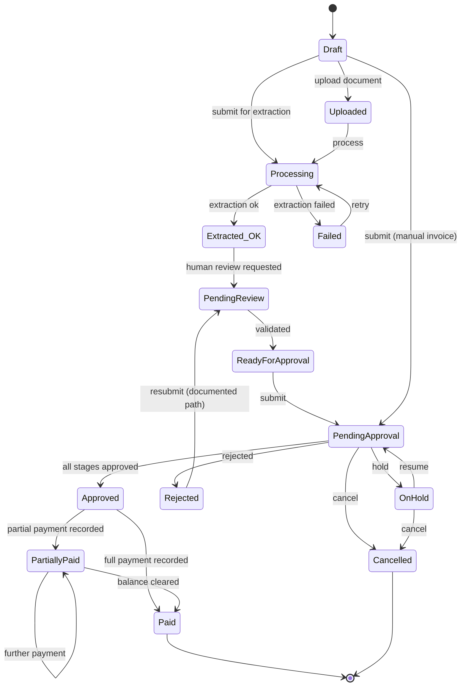

# TallyBalance AI — Initial ER Diagram

**Phase:** 0
**Status:** Draft for developer review — **no migrations are created in Phase 0**

---

## 1. Conventions

| Concern | Decision |
|---|---|
| Primary keys | `Id` — `uniqueidentifier` (GUID). Favouring write locality over GUID is a valid alternative; GUIDs are chosen because they can be generated client-side before insert, which matters for idempotency keys and outbox writes. |
| Money | `decimal(19,4)`. **Never** `float`/`double`. Currency stored as ISO 4217 `char(3)`. |
| Timestamps | `DateTimeOffset` stored UTC. Reporting layer converts to the organization's timezone. No `datetime` without offset semantics. |
| Concurrency | `RowVersion` (`rowversion`) on every mutable financial entity: Invoice, InvoiceLineItem, Adjustment, ApprovalRequest. |
| Soft delete | Only where justified: `Vendor` (archive), `Document` (quarantine). **Never** on financial records — those are append-only or state-transitioned. |
| Tenant | Every tenant-owned entity has `OrganizationId` (or inherits it via its aggregate root, documented per table). |
| Cascades | Financial relationships are `NO ACTION` with application guards. Cascade delete is permitted only for true composition children owned by the same aggregate within the same tenant (e.g. line items under an invoice), and must be stated explicitly in the migration. |
| Indexes | Composite, **tenant-leading**: `(OrganizationId, <filter column>, <sort column>)`. Tenant is the most selective predicate in a multi-tenant system and every query is filtered by it. |

---

## 2. Identity

```mermaid
erDiagram
    USERS ||--o{ USER_ROLES : has
    ROLES ||--o{ USER_ROLES : assigned
    ROLES ||--o{ ROLE_PERMISSIONS : grants
    PERMISSIONS ||--o{ ROLE_PERMISSIONS : included_in
    USERS ||--o{ REFRESH_TOKENS : owns
    USERS ||--o{ USER_SESSIONS : has
    USERS ||--o{ PASSWORD_RESET_TOKENS : requests

    USERS {
        guid Id PK
        string UserName
        string EmailAddress UK
        string PasswordHash
        bool IsLockedOut
        DateTimeOffset? LockoutEnd
        DateTimeOffset CreatedAt
        DateTimeOffset? LastLoginAt
        bool IsDeleted
    }
    ROLES {
        guid Id PK
        string Name UK
        string Description
    }
    PERMISSIONS {
        guid Id PK
        string Code UK "e.g. invoice.adjust"
        string Description
    }
    USER_ROLES {
        guid UserId PK,FK
        guid RoleId PK,FK
    }
    ROLE_PERMISSIONS {
        guid RoleId PK,FK
        guid PermissionId PK,FK
    }
    REFRESH_TOKENS {
        guid Id PK
        guid UserId FK
        string TokenHash "never the raw token"
        string FamilyId "rotation family"
        DateTimeOffset ExpiresAt
        DateTimeOffset? RevokedAt
        string? ReplacedByTokenHash
        string CreatedByIp
    }
    USER_SESSIONS {
        guid Id PK
        guid UserId FK
        DateTimeOffset StartedAt
        DateTimeOffset? RevokedAt
        string UserAgent
        string Ip
    }
    PASSWORD_RESET_TOKENS {
        guid Id PK
        guid UserId FK
        string TokenHash
        DateTimeOffset ExpiresAt
        bool IsUsed
    }
```

**Notes**
- `RefreshTokens.FamilyId` groups a rotation chain. Reuse of an already-rotated token revokes the
  entire family — this is how token theft is detected.
- Tokens are stored **hashed**. A database dump must not yield usable tokens.
- Identity is deliberately **organization-free**. Tenant membership lives in Organizations.

---

## 3. Organizations (the tenant authority)

```mermaid
erDiagram
    ORGANIZATIONS ||--o{ ORGANIZATION_MEMBERS : has
    USERS ||--o{ ORGANIZATION_MEMBERS : belongs
    ORGANIZATIONS ||--o{ ORGANIZATION_SETTINGS : configured_by
    ORGANIZATIONS ||--o{ ORGANIZATION_INVITATIONS : invites

    ORGANIZATIONS {
        guid Id PK
        string Name
        string Slug UK
        string DefaultCurrencyCode "ISO 4217, default INR"
        string TimeZoneId "default Asia/Kolkata"
        string Status "Active|Suspended"
        DateTimeOffset CreatedAt
        RowVersion
    }
    ORGANIZATION_MEMBERS {
        guid Id PK
        guid OrganizationId FK
        guid UserId FK
        guid RoleId FK
        string Status "Active|Removed"
        DateTimeOffset JoinedAt
    }
    ORGANIZATION_SETTINGS {
        guid OrganizationId PK,FK
        string TaxMode "PerLine|InvoiceLevel|Both"
        string DiscountMode "PerLine|InvoiceLevel|Both"
        string TaxRoundingPolicy "NearestRupee|TwoDecimals|HalfUp|BankersRounding"
        string AmountRoundingPolicy "TwoDecimals|NearestRupee|HalfUp|BankersRounding"
        int DefaultTaxRatePercent "19,4, GST default"
        bool AllowMixedTaxModes "override per invoice"
        bool AllowMixedDiscountModes "override per invoice"
        int ApprovalEscalationDays
        bool AiEnabled
        string PaymentTermsDefaultDays
    }
    ORGANIZATION_INVITATIONS {
        guid Id PK
        guid OrganizationId FK
        string Email
        guid RoleId FK
        string TokenHash
        DateTimeOffset ExpiresAt
        DateTimeOffset? AcceptedAt
        string InvitedBy
    }
```

**Notes**
- `ORGANIZATION_MEMBERS` is the **membership join that defines tenancy**. Tenant resolution =
  "authenticated user ∩ active membership in this organization". Nothing else grants access.
- Unique constraint: `(OrganizationId, UserId)` where `Status = 'Active'`.
- `ORGANIZATION_SETTINGS` is 1:1 and holds the tax/discount mode, rounding policies, and AI flag.

### DECISION (2026-11-10, developer-approved): base currency is INR

- `Organizations.DefaultCurrencyCode` defaults to **`INR`**. New organizations are created with INR.
- `TimeZoneId` defaults to **`Asia/Kolkata`** so that reporting dates align with Indian business days.
- INR has two minor units (paise), so the default `AmountRoundingPolicy` is `TwoDecimals` with
  `MidpointRounding` explicitly configured — never left to language defaults.
- **GST reality check:** Indian GST practice commonly rounds the *tax amount* to the nearest rupee,
  while line amounts keep paise. That is exactly why `TaxRoundingPolicy` is a **separate** setting
  from `AmountRoundingPolicy`. Collapsing them into one setting would force the wrong choice on one
  of the two.
- Currency is still stored per-invoice (`Invoices.CurrencyCode`), because a single Indian organization
  may legitimately hold USD or EUR vendor invoices. INR is the *default and reporting* currency, not
  a constraint on individual invoices.

### DECISION (2026-11-10, developer-approved): tax and discount configurable at BOTH levels

Tax and discount may be applied **per line item**, **at invoice level**, or **both**, controlled by
`ORGANIZATION_SETTINGS.TaxMode` and `.DiscountMode`. This is editable by an Organization
Administrator / Finance Manager on the **Settings → Financial Configuration** page.

| Mode | Meaning | Reconciliation rule |
|---|---|---|
| `PerLine` | Tax/discount exists only on line items | `Invoice.TaxAmount == Σ LineItem.TaxAmount` |
| `InvoiceLevel` | Tax/discount exists only on the invoice header | `LineItem.TaxAmount == 0`; header value validated independently |
| `Both` | Both may be present | `Invoice.TaxAmount == Σ LineItem.TaxAmount + HeaderAdditionalTaxAmount` |

Design consequences:
- `AllowMixedTaxModes` / `AllowMixedDiscountModes` permit a **per-invoice override** of the org
  default, for the common case where one invoice is taxed differently from the org norm.
- The reconciliation rule is selected **at validation time from the effective mode**, so the same
  validator cannot silently accept two different interpretations of "totals reconcile".
- The effective mode is **snapshotted onto the invoice** (`EffectiveTaxMode`) at creation, so a later
  settings change cannot retroactively make an existing invoice's stored totals inconsistent. This
  is the same versioning principle used for approval workflow versions.

---

## 4. Vendors

```mermaid
erDiagram
    ORGANIZATIONS ||--o{ VENDORS : owns
    VENDORS ||--o{ VENDOR_CONTACTS : has
    VENDORS ||--o{ VENDOR_ADDRESSES : has

    VENDORS {
        guid Id PK
        guid OrganizationId FK
        string VendorName
        string? TaxIdentifier "GSTIN, encrypted at rest"
        string? PanNumber "encrypted at rest, drives TDS rate"
        bool PanVerified
        string VendorType "Individual|HUF|Company|Firm|Government|Other"
        bool IsTdsApplicable
        string? TdsSectionOverride "194C|194J etc, null means resolve by type"
        bool HigherTdsRateApplicable "manual flag, e.g. non-resident"
        string DefaultCurrencyCode
        int PaymentTermsDays
        string Status "Active|Archived"
        DateTimeOffset CreatedAt
        DateTimeOffset? ArchivedAt
        RowVersion
    }
    VENDOR_CONTACTS {
        guid Id PK
        guid VendorId FK
        string FullName
        string? EmailAddress
        string? Phone
    }
    VENDOR_ADDRESSES {
        guid Id PK
        guid VendorId FK
        string AddressType "Billing|RemitTo"
        string Line1
        string? Line2
        string City
        string PostalCode
        string CountryCode
    }
```

**Notes**
- Uniqueness is **organization-scoped**: `UNIQUE (OrganizationId, VendorName)` and
  `UNIQUE (OrganizationId, TaxIdentifier)` where present — not global.
- `TaxIdentifier` (GSTIN) and `PanNumber` are encrypted at rest and masked in all list/API responses.
- Archive (soft delete) is used here because invoices must keep referring to a vendor forever.
- **`VendorType` and `PanNumber` exist because of TDS.** The applicable TDS rate is a function of
  the section, the vendor type, and whether a valid PAN is quoted — a missing PAN can trigger a
  significantly higher rate under section 206AA. Without these fields on the vendor, TDS cannot be
  computed correctly, so they are prerequisites of the TDS decision rather than optional extras.

### GST rate source (2026-11-10, developer-approved): validated against HSN/SAC

`InvoiceLineItem.HsnSacCode` is **required** and its rate is **validated against the
`GST_RATES` reference table** — it is not free-entry. See §14.

Consequences:
- A line item whose HSN/SAC is unknown to the reference table is **rejected**, not silently accepted
  at 0% tax. Silently defaulting to 0% would understate tax and be invisible in the UI.
- The rate is **looked up and snapshotted** onto the line item (`TaxRatePercent` + `GstRateId` +
  `GstRateEffectiveFrom`) at entry time. GST rates are revised by the council from time to time, so
  an invoice must record which rate table it was priced against — otherwise a future rate update
  would retroactively change historical invoices' reconciliation.
- Rate validity is **date-scoped**: the lookup uses the invoice date, not today, so back-dated
  invoices resolve correctly.

---

## 5. Invoices (core aggregate)

```mermaid
erDiagram
    ORGANIZATIONS ||--o{ INVOICES : owns
    VENDORS ||--o{ INVOICES : billed_by
    INVOICES ||--o{ INVOICE_LINE_ITEMS : contains
    INVOICES ||--o{ INVOICE_STATUS_HISTORY : transitions
    INVOICES ||--o{ INVOICE_DOCUMENTS : attached
    DOCUMENTS ||--o{ INVOICE_DOCUMENTS : attached_as
    INVOICES ||--o{ PAYMENTS : settled_by

    INVOICES {
        guid Id PK
        guid OrganizationId FK
        guid VendorId FK
        string InvoiceNumber
        Date InvoiceDate
        Date? DueDate
        string CurrencyCode "default INR"
        decimal Subtotal "19,4"
        decimal LineTaxAmount "19,4, sum of line taxes"
        decimal HeaderTaxAmount "19,4, invoice-level tax"
        decimal TaxAmount "19,4, derived = LineTax + HeaderTax"
        decimal LineDiscountAmount "19,4, sum of line discounts"
        decimal HeaderDiscountAmount "19,4, invoice-level discount"
        decimal DiscountAmount "19,4, derived = Line + Header"
        decimal TotalAmount "19,4, derived and validated"
        decimal PaidAmount "19,4, derived from PAYMENTS"
        decimal OutstandingAmount "19,4, derived = Total - Paid"
        decimal TdsAmount "19,4, derived from TDS_DEDUCTIONS"
        decimal NetPayableAmount "19,4, derived = Total - Tds - Paid"
        bool IsTdsApplicable
        string EffectiveTdsMode "Auto|Manual|NotApplicable, snapshotted"
        string EffectiveTaxMode "PerLine|InvoiceLevel|Both, snapshotted"
        string EffectiveDiscountMode "PerLine|InvoiceLevel|Both, snapshotted"
        string Status "state machine"
        string? Description
        guid CreatedBy
        DateTimeOffset CreatedAt
        DateTimeOffset UpdatedAt
        RowVersion
    }
    INVOICE_LINE_ITEMS {
        guid Id PK
        guid InvoiceId FK
        int LineNumber
        string Description
        decimal Quantity "19,4"
        decimal UnitPrice "19,4"
        string HsnSacCode "required, validated against GST_RATES"
        guid? GstRateId FK "snapshot of the rate row used"
        string GstRateEffectiveFrom "snapshot for reproducibility"
        decimal TaxRatePercent "19,4, derived from HSN/SAC lookup"
        decimal TaxAmount "19,4, derived from rate"
        decimal DiscountAmount "19,4, per-line discount"
        decimal LineTotal "19,4, derived"
        string? AccountCode
        string? CostCenter
        RowVersion
    }
    PAYMENTS {
        guid Id PK
        guid OrganizationId FK
        guid InvoiceId FK
        decimal Amount "19,4"
        string CurrencyCode
        Date PaymentDate
        string PaymentMethod "NEFT|RTGS|UPI|Cheque|Card|Other"
        string? ReferenceNumber
        string Status "Pending|Cleared|Reversed|Voided"
        string IdempotencyKey UK
        string Notes
        guid RecordedBy
        DateTimeOffset RecordedAt
        RowVersion
    }
    INVOICE_STATUS_HISTORY {
        guid Id PK
        guid InvoiceId FK
        string FromStatus
        string ToStatus
        string Reason
        guid ChangedBy
        DateTimeOffset ChangedAt
        string CorrelationId
    }
    INVOICE_DOCUMENTS {
        guid InvoiceId PK,FK
        guid DocumentId PK,FK
        DateTimeOffset AttachedAt
    }
```

### Invoice state machine (authoritative)



**Rules**
- Status changes happen **only** through explicit transition commands (`/submit`, `/hold`,
  `/cancel`, approval decisions, payment recording). A generic `PUT /invoices/{id}` **cannot** set
  `Status`.
- Every transition is written to `INVOICE_STATUS_HISTORY` with actor, reason, and correlation ID.
- `Rejection → PendingReview` is the only documented resubmission path.
- `Extracted_OK` is an internal state surfaced to users as `PendingReview`.

### Derived amounts — never client-supplied

Every amount below is **computed and validated server-side**. The API rejects any request that
attempts to set them directly.

| Field | Derivation |
|---|---|
| `LineTaxAmount` | `Σ LineItem.TaxAmount` |
| `TaxAmount` | `LineTaxAmount + HeaderTaxAmount` (per `EffectiveTaxMode`) |
| `DiscountAmount` | `LineDiscountAmount + HeaderDiscountAmount` (per `EffectiveDiscountMode`) |
| `TotalAmount` | `Subtotal + TaxAmount − DiscountAmount`, rounded per `AmountRoundingPolicy` |
| `PaidAmount` | `Σ Payments.Amount WHERE Status = 'Cleared'` |
| `TdsAmount` | `Σ TDS_Deductions.TdsAmount WHERE Status IN ('Computed','Deposited')` |
| `NetPayableAmount` | `TotalAmount − TdsAmount − PaidAmount` |
| `OutstandingAmount` | `TotalAmount − PaidAmount` |

`PaidAmount` and `OutstandingAmount` are **stored for read performance but derived for truth**: they
are recomputed inside the same transaction as every payment write, and a consistency check can
rebuild them from `PAYMENTS` at any time. If stored and derived ever disagree, derived wins and the
discrepancy is logged as an invariant violation.

### Reconciliation rules by effective mode

Validated inside the write transaction. Violation aborts the whole transaction.

| `EffectiveTaxMode` | Rule that must hold |
|---|---|
| `PerLine` | `HeaderTaxAmount == 0` and `TaxAmount == Σ LineItem.TaxAmount` |
| `InvoiceLevel` | every `LineItem.TaxAmount == 0` and `TaxAmount == HeaderTaxAmount` |
| `Both` | `TaxAmount == Σ LineItem.TaxAmount + HeaderTaxAmount` |

The same three-way shape applies to `EffectiveDiscountMode`.

**Why the mode is snapshotted onto the invoice:** if the mode were read live from
`ORGANIZATION_SETTINGS`, an administrator changing the setting would instantly make previously-valid
invoices fail their own reconciliation check. Pinning the mode at creation is the same principle as
pinning an approval workflow version — in-flight records are immune to later configuration changes.

### Payment rules (payment is in scope)

- Only `Cleared` payments count toward `PaidAmount`; `Pending` does not.
- `Reversed` and `Voided` payments do not count, and — consistent with the append-only principle —
  they are **never deleted**. A reversal is a new record, auditable like an adjustment undo.
- Overpayment beyond `TotalAmount` is rejected by a business rule unless explicitly permitted.
- `Approved → Paid` / `PartiallyPaid` transitions are driven by payment recording, never by a manual
  status edit.
- Payment recording requires an `IdempotencyKey`, exactly like adjustments — a retried request must
  not double-count money.
- `PAYMENTS` carries `RowVersion`, so two users recording payments concurrently cannot silently
  overwrite each other.
- Payment methods listed are Indian-market defaults (NEFT, RTGS, UPI, Cheque) reflecting the INR
  base-currency decision.

---

## 6. Adjustments (append-only ledger)

```mermaid
erDiagram
    INVOICES ||--o{ ADJUSTMENTS : has
    INVOICE_LINE_ITEMS ||--o{ ADJUSTMENTS : applies_to
    ADJUSTMENTS ||--o{ ADJUSTMENTS : parent_of
    ADJUSTMENTS ||--o{ ADJUSTMENT_HISTORY : audited_by

    ADJUSTMENTS {
        guid Id PK
        guid OrganizationId FK
        guid InvoiceId FK
        guid InvoiceLineItemId FK
        guid? ParentAdjustmentId FK
        string AdjustmentType "Increase|Decrease|Percentage|Fixed"
        decimal AdjustmentAmount "19,4 signed"
        decimal PreviousAmount "19,4"
        decimal NewAmount "19,4"
        string Reason
        string Status "Active|Undone|Reversed"
        string IdempotencyKey UK
        guid CreatedBy
        DateTimeOffset CreatedAt
        RowVersion
    }
    ADJUSTMENT_HISTORY {
        guid Id PK
        guid AdjustmentId FK
        string Operation "Applied|Undone|Redone"
        string PreviousState
        string NewState
        string UndoSnapshot "JSON"
        guid ActorId
        DateTimeOffset CreatedAt
        string CorrelationId
    }
```

### Semantics (must be agreed — this is the heart of the system)

| Concept | Definition |
|---|---|
| **Apply** | Insert a new `ADJUSTMENT` row with `Status = Active`. Never mutate the line item's stored amount directly; the effective amount is derived from the ledger. |
| **Undo** | Mark the target adjustment `Status = Undone` and insert an `ADJUSTMENT_HISTORY` row with `Operation = Undone` plus the snapshot needed to redo it. **No row is deleted.** |
| **Redo** | Flip `Status` back to `Active` and insert a `Redone` history row. Only the most recently undone adjustment in a stack may be redone (stack discipline). |
| **Effective line amount** | `baseAmount + Σ(AdjustmentAmount WHERE Status = 'Active')`, ordered by `CreatedAt`. Deterministic and reproducible from history alone. |
| **Undo/redo ordering** | LIFO over the active stack for that line item. Undoing a non-top adjustment requires an explicit documented decision — the default is to reject with a business-rule error rather than silently reorder history. |

**Verification sequence that must be covered by automated tests** (from the spec):
base 1,000 → +100 → +500 → −200 → undo → undo → redo.
Expected effective amounts: 1100, 1600, 1400, 1600, 1100, 1600.

**Guarantees**
- `IdempotencyKey` is unique per organization: a duplicate submission returns the original result
  and does **not** apply a second adjustment.
- Applying an adjustment writes: adjustment row + history row + outbox event, in **one transaction**,
  guarded by the line item's `RowVersion`.
- Financial invariants (no prohibited negative balances, totals reconcile) are checked inside the
  transaction; violation aborts the whole transaction.

---

## 7. Approvals

```mermaid
erDiagram
    ORGANIZATIONS ||--o{ APPROVAL_WORKFLOWS : defines
    APPROVAL_WORKFLOWS ||--o{ APPROVAL_WORKFLOW_VERSIONS : versioned_as
    APPROVAL_WORKFLOW_VERSIONS ||--o{ APPROVAL_STAGES : contains
    INVOICES ||--o{ APPROVAL_REQUESTS : requests
    APPROVAL_WORKFLOW_VERSIONS ||--o{ APPROVAL_REQUESTS : evaluated_by
    APPROVAL_REQUESTS ||--o{ APPROVAL_ASSIGNMENTS : assigns
    APPROVAL_STAGES ||--o{ APPROVAL_ASSIGNMENTS : belongs
    APPROVAL_ASSIGNMENTS ||--o{ APPROVAL_ACTIONS : decided_by
    APPROVAL_REQUESTS ||--o{ APPROVAL_COMMENTS : discussed

    APPROVAL_WORKFLOWS {
        guid Id PK
        guid OrganizationId FK
        string Name
        string Status "Active|Inactive"
    }
    APPROVAL_WORKFLOW_VERSIONS {
        guid Id PK
        guid WorkflowId FK
        int VersionNumber
        string Status "Draft|Published|Retired"
        DateTimeOffset PublishedAt
    }
    APPROVAL_STAGES {
        guid Id PK
        guid WorkflowVersionId FK
        int StageOrder
        string ApprovalMode "Sequential|Parallel"
        string RequiredRoleOrPermission
        decimal? MinAmount "19,4"
        decimal? MaxAmount "19,4"
        int? EscalationDays
    }
    APPROVAL_REQUESTS {
        guid Id PK
        guid OrganizationId FK
        guid InvoiceId FK
        guid WorkflowVersionId FK "pinned at creation"
        string Status "Pending|Approved|Rejected|ChangesRequested|Cancelled"
        guid? CurrentStageId
        DateTimeOffset SubmittedAt
        DateTimeOffset? CompletedAt
        RowVersion
    }
    APPROVAL_ASSIGNMENTS {
        guid Id PK
        guid ApprovalRequestId FK
        guid StageId FK
        guid AssigneeId
        string Status "Pending|Approved|Rejected|Skipped"
        DateTimeOffset? DecidedAt
    }
    APPROVAL_ACTIONS {
        guid Id PK
        guid AssignmentId FK
        string Action "Approve|Reject|RequestChanges|Reassign|Escalate"
        string? Comment
        guid ActorId
        DateTimeOffset ActedAt
    }
    APPROVAL_COMMENTS {
        guid Id PK
        guid ApprovalRequestId FK
        guid AuthorId
        string Body
        DateTimeOffset CreatedAt
    }
```

**Critical rule:** `APPROVAL_REQUESTS.WorkflowVersionId` is **pinned at creation**. Editing a
workflow creates a new version; in-flight requests keep evaluating against the version they started
with. Without this, changing a threshold mid-flight would silently alter live approvals.

---

## 8. Documents

```mermaid
erDiagram
    ORGANIZATIONS ||--o{ DOCUMENTS : owns
    DOCUMENTS ||--o{ DOCUMENT_VERSIONS : has
    DOCUMENTS ||--o{ DOCUMENT_PROCESSING_JOBS : processed_by
    DOCUMENT_VERSIONS ||--o{ DOCUMENT_EXTRACTION_RESULTS : extracted_as

    DOCUMENTS {
        guid Id PK
        guid OrganizationId FK
        string OriginalFileName "display only, never a path"
        string StorageKey "server-generated"
        string ContentType "sniffed, not client-declared"
        bigint FileSizeBytes
        string Sha256Hash "UK per org — dedup + integrity"
        string Status "Uploaded|PendingProcessing|Processing|Extracted|AwaitingReview|Completed|Failed|Rejected|Quarantined"
        int VersionNumber
        DateTimeOffset UploadedAt
        guid UploadedBy
    }
    DOCUMENT_VERSIONS {
        guid Id PK
        guid DocumentId FK
        int VersionNumber
        string StorageKey
        string Sha256Hash
        DateTimeOffset CreatedAt
    }
    DOCUMENT_PROCESSING_JOBS {
        guid Id PK
        guid DocumentId FK
        string JobType "TextExtraction|Embedding|Summarization"
        string Status "Pending|Running|Succeeded|Failed"
        int AttemptCount
        string? LastError
        DateTimeOffset? StartedAt
        DateTimeOffset? CompletedAt
    }
    DOCUMENT_EXTRACTION_RESULTS {
        guid Id PK
        guid DocumentVersionId FK
        string ExtractedJson "typed schema"
        string ValidationWarnings "JSON array"
        string SourceReferences "page/offset refs"
        bool ReviewedByHuman
        guid? ReviewedBy
        DateTimeOffset ExtractedAt
    }
```

**Notes**
- `StorageKey` is server-generated (GUID-based). The original filename is display metadata only and
  is **never** used to construct a path — this is the path-traversal defence.
- `Sha256Hash` unique per organization gives both integrity verification and cheap duplicate
  detection.
- No binary content in SQL Server. Bytes live in file storage.

---

## 9. AI

```mermaid
erDiagram
    ORGANIZATIONS ||--o{ AI_ANALYSES : has
    INVOICES ||--o{ AI_ANALYSES : analysed_as
    AI_ANALYSES ||--o{ AI_RECOMMENDATIONS : suggests
    AI_RECOMMENDATIONS ||--o| AI_ACTION_REQUESTS : may_trigger
    ORGANIZATIONS ||--o{ AI_CONVERSATIONS : has
    AI_CONVERSATIONS ||--o{ AI_CONVERSATION_MESSAGES : contains
    DOCUMENTS ||--o{ AI_EMBEDDING_REFERENCES : embedded_as
    AI_ANALYSES ||--o{ AI_EVALUATION_RESULTS : evaluated_by

    AI_ANALYSES {
        guid Id PK
        guid OrganizationId FK
        guid InvoiceId FK
        string AnalysisType "Extraction|Summary|Qa|Duplicate|Anomaly"
        string ModelId "from configuration"
        string PromptVersion
        string ResultJson
        string SourceReferences
        int? TokenUsage
        DateTimeOffset CreatedAt
    }
    AI_CONVERSATIONS {
        guid Id PK
        guid OrganizationId FK
        guid InvoiceId FK
        guid CreatedBy
        string Title
        DateTimeOffset CreatedAt
    }
    AI_CONVERSATION_MESSAGES {
        guid Id PK
        guid ConversationId FK
        string Role "User|Assistant|System"
        string Content
        string Citations "JSON, authorized sources only"
        DateTimeOffset CreatedAt
    }
    AI_EMBEDDING_REFERENCES {
        guid Id PK
        guid OrganizationId FK
        guid DocumentId FK
        string QdrantCollection
        string QdrantPointId
        string EmbeddingModelId
        int ChunkCount
        DateTimeOffset CreatedAt
    }
    AI_RECOMMENDATIONS {
        guid Id PK
        guid AnalysisId FK
        string RecommendationType "FlagForReview|RequestMissingInfo|SuggestAdjustment|SuggestVendorMatch|SuggestDuplicate|SuggestRouting"
        string Rationale
        string Status "Proposed|Confirmed|Dismissed"
        guid? ConfirmedBy
        DateTimeOffset? ConfirmedAt
    }
    AI_ACTION_REQUESTS {
        guid Id PK
        guid RecommendationId FK
        string RequestedAction
        string PayloadJson
        string Status "AwaitingHuman|Confirmed|Rejected|Expired"
        guid? DecidedBy
        DateTimeOffset? DecidedAt
    }
    AI_EVALUATION_RESULTS {
        guid Id PK
        guid AnalysisId FK
        string MetricName
        decimal Score "19,4"
        string Notes
        DateTimeOffset CreatedAt
    }
```

**Safety invariants encoded in the schema**
- There is **no** foreign key from an AI table to `ADJUSTMENTS` or `APPROVAL_ACTIONS`. AI output
  cannot write financial state; it can only create an `AI_ACTION_REQUEST` in `AwaitingHuman`.
- A human `DecidedBy` + `DecidedAt` is required before any downstream effect.
- `AI_EMBEDDING_REFERENCES` carries `OrganizationId` so retrieval can be filtered before any
  similarity search reaches Qdrant.
- `ModelId` and `PromptVersion` are stored per analysis so results are reproducible and auditable.

---

## 10. Notifications

```mermaid
erDiagram
    ORGANIZATIONS ||--o{ NOTIFICATIONS : has
    USERS ||--o{ NOTIFICATIONS : receives
    USERS ||--o{ NOTIFICATION_PREFERENCES : configures
    NOTIFICATIONS ||--o{ NOTIFICATION_DELIVERY_ATTEMPTS : delivered_by

    NOTIFICATIONS {
        guid Id PK
        guid OrganizationId FK
        guid UserId FK
        string Type
        string Title
        string Body
        string? EntityType
        guid? EntityId
        bool IsRead
        DateTimeOffset CreatedAt
        string DedupeKey "UK per user+type+entity"
    }
    NOTIFICATION_PREFERENCES {
        guid Id PK
        guid UserId FK
        guid OrganizationId FK
        string Type
        bool InAppEnabled
        bool EmailEnabled
    }
    NOTIFICATION_DELIVERY_ATTEMPTS {
        guid Id PK
        guid NotificationId FK
        string Channel "InApp|Email"
        int AttemptNumber
        string Status "Pending|Succeeded|Failed|DeadLettered"
        string? Error
        DateTimeOffset AttemptedAt
    }
```

`DedupeKey` unique per `(UserId, Type, EntityId)` is what prevents duplicate notifications when a
message is redelivered — the consumer-side half of idempotency.

---

## 11. Infrastructure tables

```mermaid
erDiagram
    OUTBOX_MESSAGES {
        guid Id PK
        string EventType
        string PayloadJson
        guid? OrganizationId "tenant preserved for consumers"
        DateTimeOffset OccurredAt
        DateTimeOffset? PublishedAt
        int AttemptCount
        string? LastError
    }
    IDEMPOTENCY_RECORDS {
        guid Id PK
        guid OrganizationId FK
        string IdempotencyKey UK
        string Operation
        string RequestHash
        int? ResponseStatusCode
        string? ResponseBody
        DateTimeOffset CreatedAt
        DateTimeOffset ExpiresAt
    }
    AUDIT_LOGS {
        bigint Id PK "sequential, high write volume"
        guid? OrganizationId
        guid? UserId
        string Action
        string EntityType
        guid? EntityId
        string Outcome "Success|Failure|Denied"
        string ChangeSummary "no secrets, no full documents"
        string CorrelationId
        string IpAddress
        DateTimeOffset Timestamp
    }
```

**Notes**
- `OUTBOX_MESSAGES` is the reliability backbone: written in the same transaction as the business
  change, read and marked published by a separate worker. `OrganizationId` on the event is what lets
  a background consumer re-establish tenant context.
- `AUDIT_LOGS` uses a **sequential** `bigint` key (not GUID) because it is insert-only at high
  volume — this is a deliberate exception to the GUID convention, chosen for write locality and
  index efficiency.
- Audit is **append-only at the application level**: no update/delete endpoints exist, and the
  database role used by the application has `INSERT`/`SELECT` only on this table.
- Audit records must **never** contain passwords, tokens, API keys, or full document contents.

---

## 12. GST reference and TDS (2026-11-10, developer-approved)

GST rate source is **validated against an HSN/SAC reference table**, and **TDS is in scope**. These
tables implement both decisions.

```mermaid
erDiagram
    GST_RATES ||--o{ INVOICE_LINE_ITEMS : validates
    TDS_SECTIONS ||--o{ TDS_DEDUCTIONS : applies
    TDS_SECTIONS ||--o{ TDS_RATE_RULES : defines
    INVOICES ||--o{ TDS_DEDUCTIONS : suffers
    PAYMENTS ||--o{ TDS_DEDUCTIONS : withholds

    GST_RATES {
        guid Id PK
        string HsnSacCode "indexed"
        string CodeType "HSN|SAC"
        string Description
        decimal RatePercent "19,4"
        string Unit "per cent|slab"
        Date EffectiveFrom "date-scoped"
        Date? EffectiveTo "null = current"
        string Source "Council notification ref"
        bool IsActive
    }
    TDS_SECTIONS {
        guid Id PK
        string SectionCode "194C|194J|194H|194I|206AA"
        string Description
        string NatureOfPayment "Works|ProfessionalFees|Commission|Rent|Contractor"
        bool RequiresPan "if no PAN, 206AA higher rate"
        decimal ThresholdAmount "19,4, annual aggregate"
        string CurrencyCode
        bool IsActive
    }
    TDS_RATE_RULES {
        guid Id PK
        guid SectionId FK
        string VendorType "Individual|HUF|Company|Firm|Government|Other"
        bool PanQuoted "true|false branch"
        decimal RatePercent "19,4"
        Date EffectiveFrom
        Date? EffectiveTo
    }
    TDS_DEDUCTIONS {
        guid Id PK
        guid OrganizationId FK
        guid InvoiceId FK
        guid? PaymentId FK "which payment it was withheld against"
        guid SectionId FK
        string SectionCode "denormalized for reporting"
        decimal BaseAmount "19,4, amount on which TDS computed"
        decimal RatePercent "19,4, snapshot"
        decimal TdsAmount "19,4, computed"
        string Status "Computed|Deposited|Voided"
        string? ChallanNumber "deposit reference"
        Date? DepositDate
        string ComputationBasis "Auto|ManualOverride"
        string? OverrideReason "required when ManualOverride"
        string IdempotencyKey UK
        guid ComputedBy
        DateTimeOffset ComputedAt
        RowVersion
    }
```

### GST rate validation rules

- `InvoiceLineItem.HsnSacCode` is **required** and must resolve to an active `GST_RATES` row whose
  `[EffectiveFrom, EffectiveTo]` window contains the **invoice date**.
- Unresolvable code ⇒ **rejected with a validation error**. Never silently treated as 0%.
- The resolved rate is **snapshotted** onto the line item (`TaxRatePercent`, `GstRateId`,
  `GstRateEffectiveFrom`). Later changes to `GST_RATES` never alter an existing invoice's stored tax.
- `EffectiveTo` is set rather than the row deleted when a rate is revised, preserving history.

### TDS computation rules

- **Rate resolution:** `(SectionCode, VendorType, PanQuoted)` → `TDS_RATE_RULES.RatePercent`.
  The vendor's `TdsSectionOverride` selects the section; when null, the section is derived from the
  nature of payment configured on the vendor / organization.
- **Missing PAN:** if `RequiresPan` is true and the vendor has no verified PAN, section **206AA**
  applies — a substantially higher rate. This is modelled as a distinct rate rule with
  `PanQuoted = false`, not as a special-case `if` buried in a service.
- **Threshold:** TDS applies only when the vendor's **annual aggregate** for that section exceeds
  `TDS_SECTIONS.ThresholdAmount`. The aggregate is computed across the organization's invoices for
  the financial year, so this must be a query, not a per-invoice check.
- **Snapshot everything:** `RatePercent`, `SectionCode`, and the basis are stored on each deduction.
  Rates and sections change across budgets; a deduction must remain reproducible and auditable
  against the rule that was in force on its date.
- **Append-only:** a wrong TDS is `Voided` and a new deduction computed — never edited in place, never
  deleted. Same discipline as adjustments and payment reversals.
- **Idempotency key required**, like payments and adjustments.
- **`NetPayableAmount = TotalAmount − TdsAmount − PaidAmount`** is derived and validated server-side.
- **Manual override** (`ComputationBasis = ManualOverride`) is permitted for genuine edge cases but
  **requires an `OverrideReason`** and is audited — mirroring the human-in-the-loop principle used
  for AI actions.

### What TDS deliberately does NOT do here

- It does **not** file returns, generate Form 16A, or produce CHALLAN 280 filings. It computes,
  records, and reports the deduction. Filing integration is explicitly out of scope for the
  demonstration and is documented as such rather than silently half-implemented.

---

## 13. Indexing strategy (initial)

| Table | Index | Serves |
|---|---|---|
| `INVOICES` | `(OrganizationId, Status, InvoiceDate DESC)` | Dashboard + filtered lists |
| `INVOICES` | `(OrganizationId, VendorId, InvoiceDate DESC)` | Vendor history |
| `INVOICES` | `UNIQUE (OrganizationId, VendorId, InvoiceNumber)` | **Strict invoice-number uniqueness (approved)** |
| `INVOICE_LINE_ITEMS` | `(InvoiceId, LineNumber)` | Line item load |
| `ADJUSTMENTS` | `(OrganizationId, InvoiceLineItemId, Status, CreatedAt)` | Effective-amount projection |
| `ADJUSTMENTS` | `UNIQUE (OrganizationId, IdempotencyKey)` | Idempotency |
| `APPROVAL_ASSIGNMENTS` | `(AssigneeId, Status, DecidedAt)` | "My tasks" |
| `DOCUMENTS` | `UNIQUE (OrganizationId, Sha256Hash)` | Hash-based duplicate detection |
| `NOTIFICATIONS` | `(UserId, IsRead, CreatedAt DESC)` | Notification centre |
| `PAYMENTS` | `(OrganizationId, InvoiceId, Status)` | PaidAmount projection |
| `PAYMENTS` | `UNIQUE (OrganizationId, IdempotencyKey)` | Payment idempotency |
| `GST_RATES` | `(HsnSacCode, EffectiveFrom, EffectiveTo)` | Rate lookup by code + date |
| `GST_RATES` | `UNIQUE (HsnSacCode, RatePercent, EffectiveFrom)` | Prevent duplicate rate rows |
| `TDS_RATE_RULES` | `UNIQUE (SectionId, VendorType, PanQuoted, EffectiveFrom)` | Deterministic rate resolution |
| `TDS_DEDUCTIONS` | `(OrganizationId, InvoiceId, Status)` | TDS projection per invoice |
| `TDS_DEDUCTIONS` | `UNIQUE (OrganizationId, IdempotencyKey)` | TDS idempotency |
| `OUTBOX_MESSAGES` | `(PublishedAt) WHERE PublishedAt IS NULL` | Filtered index for the publisher |
| `AUDIT_LOGS` | `(OrganizationId, Timestamp DESC)`, `(CorrelationId)` | Audit queries, tracing |

Every tenant-scoped index **leads with `OrganizationId`** because every query is tenant-filtered;
leading with it also keeps the index locally ordered by tenant, which helps buffer-cache locality.

---

## 14. Resolved decisions (2026-11-10, developer-approved)

| # | Question | Decision | Where applied |
|---|---|---|---|
| 1 | Base currency | **INR**, `Asia/Kolkata` timezone. Separate `TaxRoundingPolicy` because GST tax is conventionally rounded to the nearest rupee while line amounts keep paise. Per-invoice `CurrencyCode` still allowed for foreign vendor invoices. | `ORGANIZATIONS`, `ORGANIZATION_SETTINGS` |
| 2 | Tax / discount level | **Configurable at both levels** via `TaxMode` and `DiscountMode` (`PerLine` / `InvoiceLevel` / `Both`), editable on the **Settings → Financial Configuration** page, with optional per-invoice override. Mode is **snapshotted** onto each invoice as `EffectiveTaxMode` / `EffectiveDiscountMode` so later setting changes cannot invalidate existing totals. | `ORGANIZATION_SETTINGS`, `INVOICES`, reconciliation rules |
| 3 | Payment in scope? | **Yes.** New `PAYMENTS` table, `PaidAmount`/`OutstandingAmount` derived from cleared payments, `PartiallyPaid` state added, reversals are append-only, idempotency key required. | `PAYMENTS`, state machine, payment rules |
| 4 | Invoice number uniqueness | **Strict.** `UNIQUE (OrganizationId, VendorId, InvoiceNumber)`. `InvoiceDate` is deliberately **excluded** from the key — including it would let the same number be entered twice on different dates, which is exactly the duplicate-payment failure the constraint exists to prevent. Duplicate *detection* (Phase 12) still runs additionally and surfaces near-matches with explanations. | `INVOICES` unique index, §13 |
| 5 | GST rate source | **Validated against an HSN/SAC reference table.** `LineItem.HsnSacCode` is required and must resolve to an active `GST_RATES` row valid for the **invoice date**; unresolvable codes are **rejected, never treated as 0%**. The resolved rate is snapshotted onto the line item so later rate revisions cannot alter historical invoices. | `GST_RATES`, `INVOICE_LINE_ITEMS`, §12 |
| 6 | TDS in scope? | **Yes.** `TDS_SECTIONS` + `TDS_RATE_RULES` reference tables and an append-only `TDS_DEDUCTIONS` ledger. Rate resolved from `(SectionCode, VendorType, PanQuoted)`; missing PAN triggers the higher 206AA rate as a data-driven rule, not a special case. `TdsAmount` and `NetPayableAmount` derived. Manual override allowed but requires a reason and is audited. **Filing/returns/Form 16A are explicitly out of scope.** | `TDS_SECTIONS`, `TDS_RATE_RULES`, `TDS_DEDUCTIONS`, `VENDORS`, §12 |

### Still open

None at the schema level. Remaining choices are implementation-level and recorded in
`docs/architecture/system-overview.md` §9 — whether to include MinIO from Phase 6 or start with
plain local disk, and which OpenAI-compatible provider to use for real AI calls. Neither affects
code structure, thanks to the storage and LLM provider abstractions.
